# Kelpshell

A GNOME Shell extension that replaces the top bar with a sidebar and arranges windows in columns on a strip that scrolls sideways.

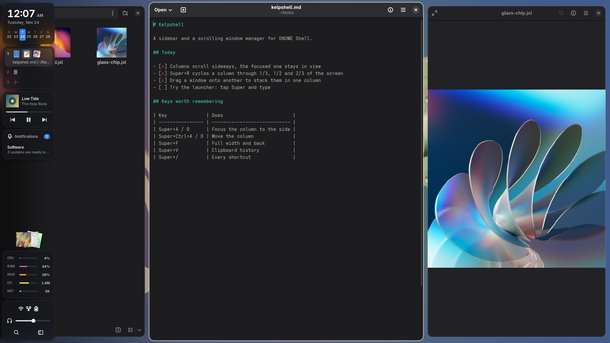

[Watch the one-minute showcase video](docs/showcase.mp4)

## Overview

Kelpshell changes how the GNOME desktop is laid out and keeps GNOME's apps, settings and session. It provides:

- **Sidebar**: clock, workspaces, media, notifications, downloads, system meters and status, as cards on the left edge
- **Scrolling window manager**: every window is a column, new windows open beside the focused one, and the view scrolls to it
- **Launcher**: apps, windows, files, settings, arithmetic and commands from one search field
- **Clipboard history and emoji picker**: opened at the text cursor
- **Window switcher**: live thumbnails of every window on every workspace
- **Lock screen**: the same look as the desktop
- **Light and dark**: follows the style chosen in Settings

It needs GNOME Shell 51 on Wayland.

## Features

### Sidebar

Cards on the left edge of the primary monitor take the place of the top bar.

- **Clock**: time, date and the current week. A click opens the calendar and the notification list.
- **Workspaces**: one row per workspace with the icons of its windows in order. Click an icon to focus the window, click it again to minimize it. Drag an icon to move the window along its row or to another workspace. Hover for a live thumbnail.
- **Monitors**: one card for each further monitor, used the same way.
- **Media**: cover, title and controls of the player that is playing.
- **Notifications**: the latest notifications. Click to open one, middle-click to dismiss it.
- **Downloads**: the newest files of the downloads folder as a pile.
- **System**: processor, memory, disk space, disk activity and network.
- **Status**: network, Bluetooth, battery and volume. A click opens quick settings, a secondary click on the volume icon lists the output devices.

`Super+B` collapses the sidebar to a strip of icons. It hides while a window is fullscreen.

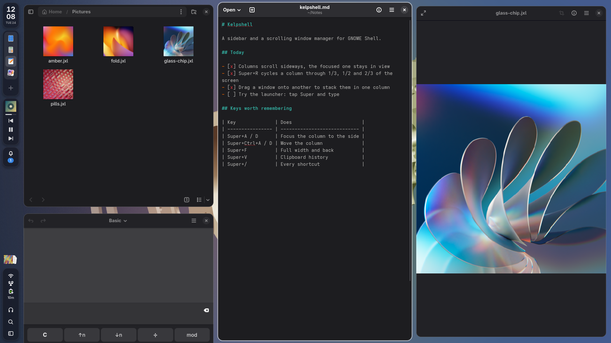

The calendar and quick settings open next to their cards.

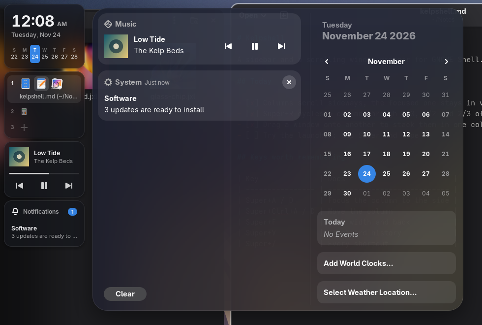

### Scrolling windows

Each workspace is a horizontal strip of columns, in the style of [niri](https://github.com/YaLTeR/niri) and [PaperWM](https://github.com/paperwm/PaperWM).

- A new window opens as a column to the right of the focused one.
- The view scrolls the least distance that shows the focused column. A column that scrolls off to the left runs on under the sidebar, blurred.
- A column holds one window or several stacked vertically.
- `Super+R` cycles the column width through 1/3, 1/2 and 2/3 of the screen. `Super+F` toggles full width. The width set for an app is remembered.
- Drag a window onto another to stack them, or between two columns to put it there. A cue shows where it lands.
- Dialogs, fixed-size windows and windows set always on top float. `Super+T` floats or tiles any window.
- Workspaces are stacked vertically and slide with their wallpaper.
- A second monitor shows all of its windows side by side. The focus and move keys cross from one monitor to the next.

### Launcher

Tap `Super`, or press `Super+Space`.

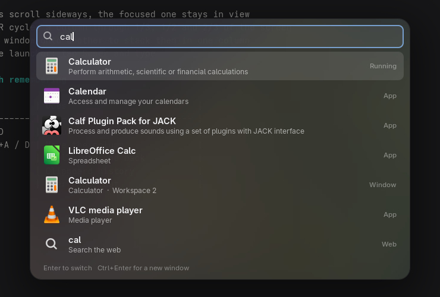

- Searches apps, open windows and system actions (lock, suspend, log out, restart, power off).
- Lists what GNOME's search providers find: files, settings panels and whatever else is turned on in Settings > Search.
- Evaluates arithmetic as you type. Enter copies the result.
- A query that starts with `>` runs a command. A typed web address opens in the browser.
- Enter opens the selected result. Ctrl+Enter opens a new window of an app that is already running.

### Window switcher

`Alt+Tab` or `Super+Tab` shows a live thumbnail of every window on every workspace, most recently used first. ``Alt+` `` lists the windows of the focused app. `W` closes the selected window.

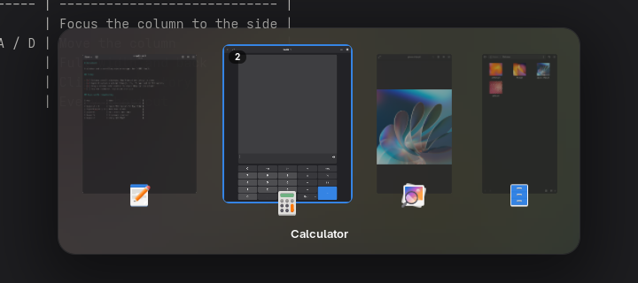

### Clipboard, emoji and symbols

`Super+V` lists the text and images copied lately. `Super+.` opens the same picker on its emoji page. Tab moves between the pages: emoji, emoticons, symbols and clipboard.

<p>
  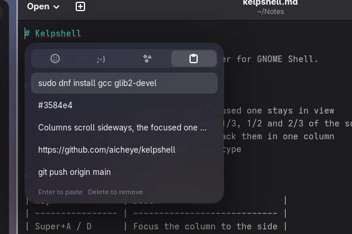
  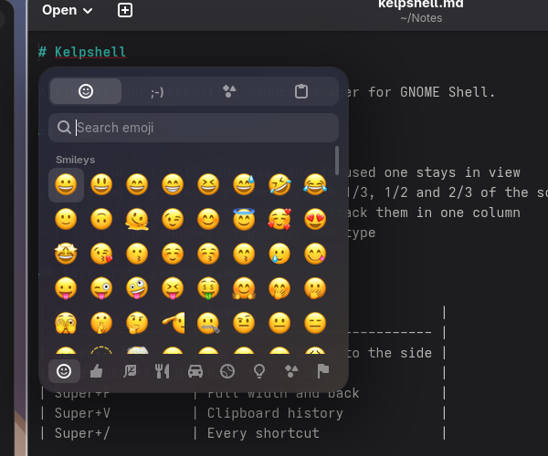
</p>

- The picker opens at the text cursor and the window keeps the keyboard focus.
- Enter or a click pastes the entry into the window.
- Typing searches the page. The search accepts small spelling slips ("hart" finds the heart).
- What a password manager copies is left out, for programs that mark it.
- The history is kept in memory only and ends with the session.

### Downloads

The newest files of the downloads folder lie in a pile above the system card. Under the pointer the pile spreads out. Click a file to open it, right-click to show it in the file manager, or drag it out and drop it on a window. A click on the folder opens a grid of the newest files.

<p>
  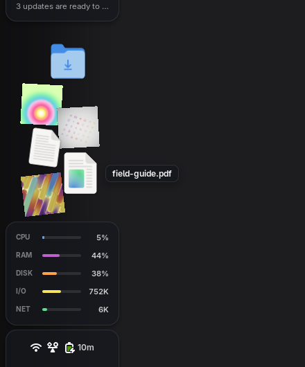
  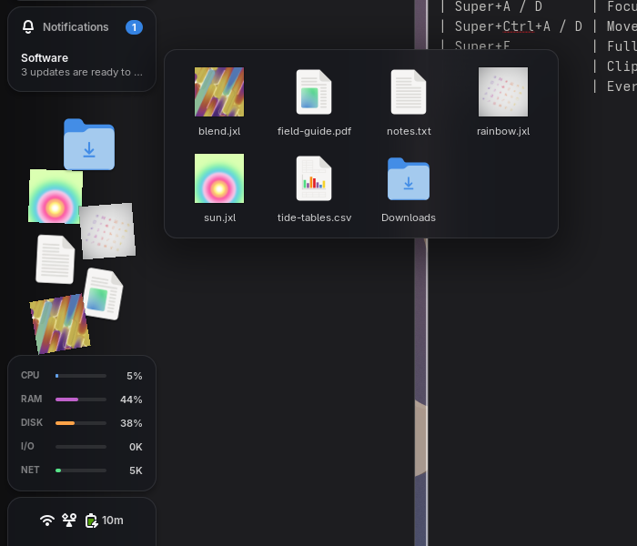
</p>

### Shortcut sheet

`Super+/` shows every shortcut as it is set in the config file.

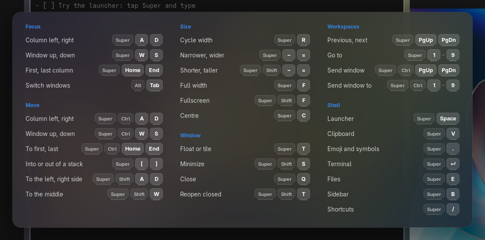

### Lock screen

The lock screen has the clock of the sidebar on a blurred picture of the wallpaper, with media players and notifications as cards. The session comes back from a lock as it was left: no window moves or changes size.

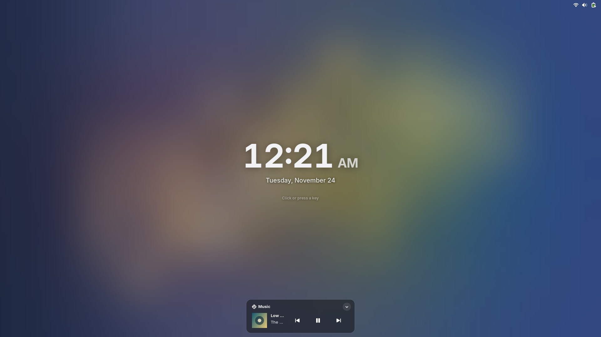

### Light and dark

Everything follows the style chosen in Settings > Appearance, the shell's own popups and banners included.

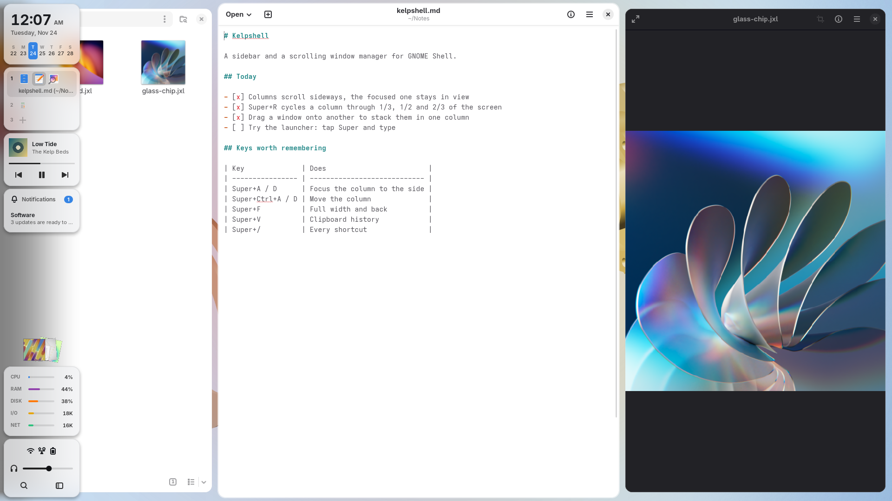

### Gestures

| Gesture | Action |
| --- | --- |
| Three fingers sideways | Scroll the strip. The windows follow the fingers and settle on a column |
| Three fingers up or down | Switch workspace |
| Four fingers up or down | Open or close the launcher |
| Three fingers sideways over a fullscreen window | Bring the next window, or the sidebar, in over it |

Two-finger scrolling is evened out between toolkits, so GTK, Firefox and Chromium windows scroll the same distance for the same movement.

## Keybindings

Every key is set in the config file. These are the defaults.

| Key | Action |
| --- | --- |
| `Super+A` / `D`, or `Super+Left` / `Right` | Focus the column to the left or right, then the next monitor |
| `Super+W` / `S`, or `Super+Up` / `Down` | Focus the window above or below, then the next workspace |
| `Super+Home` / `End` | Focus the first or last column |
| `Super+Ctrl+A` / `D`, or `Super+Ctrl+Left` / `Right` | Move the column, then to the next monitor |
| `Super+Ctrl+W` / `S`, or `Super+Ctrl+Up` / `Down` | Move the window in its column, then to the next workspace |
| `Super+Ctrl+Home` / `End` | Move the column to the first or last place |
| `Super+[` / `]` | Stack the window into the neighbouring column, or take it out of a stack |
| `Super+R` | Cycle the column width through 1/3, 1/2 and 2/3 |
| `Super+-` / `=` | Narrow or widen the column |
| `Super+Shift+-` / `=` | Shrink or grow the window in a stack |
| `Super+F` | Toggle full width |
| `Super+Shift+F` | Fullscreen |
| `Super+C`, `Super+Shift+W` | Centre the column |
| `Super+Shift+A` / `D` | Slide the column to the left or right side of the screen |
| `Super+T` | Float or tile the window |
| `Super+Shift+S` | Minimize the window |
| `Super+Q` | Close the window |
| `Super+Shift+T` | Reopen the app whose window was closed last |
| `Super+Page Up` / `Page Down` | Previous or next workspace |
| `Super+1` to `9` | Go to a workspace |
| `Super+Ctrl+1` to `9` | Move the window to a workspace |
| `Super+Ctrl+Page Up` / `Page Down` | Move the window to the previous or next workspace |
| `Super` or `Super+Space` | Launcher |
| `Super+V` | Clipboard history |
| `Super+.` | Emoji and symbols |
| `Super+Return` | Terminal |
| `Super+E` | Files |
| `Super+B` | Collapse or expand the sidebar |
| `Super+/` | Shortcut sheet |
| `Alt+Tab`, `Super+Tab` | Window switcher |

GNOME uses some of these combinations itself (`Super+S`, `Super+Space`, `Super+1`). While Kelpshell is enabled it takes each conflicting combination out of the GNOME setting that holds it, and puts it back when it is disabled.

## Installation

### Prerequisites

- GNOME Shell 51 in a Wayland session
- Python 3
- Optional, for the native modules: `gcc` and the GLib headers (Fedora: `sudo dnf install gcc glib2-devel`)

### Install

```bash
git clone https://github.com/aicheye/kelpshell.git
cd kelpshell
./install.sh
```

Then log out and back in, disable any other tiling extension, and run:

```bash
gnome-extensions enable kelpshell@aicheye
```

The script links the extension into `~/.local/share/gnome-shell/extensions`, so a `git pull` updates it at the next login. It also creates `~/.config/kelpshell/config.jsonc` if there is none.

### Native modules

Three small C modules add what a shell extension cannot do in JavaScript: a title bar for apps that would otherwise draw a fallback frame (Spotify and other Chromium apps), dragging a file from the downloads pile into a window, and even touchpad scrolling. `install.sh` builds them when `gcc` is installed. Everything else works without them.

They are built for the installed GNOME Shell version. Run `./install.sh` again after an upgrade of GNOME.

### Uninstall

```bash
./install.sh --uninstall
```

This disables the extension and removes the link. The top bar, the overview and every changed GNOME setting come back. The config file is kept.

## Configuration

Settings are in `~/.config/kelpshell/config.jsonc`. Saving the file applies it. A file that does not parse is reported in a notification and the previous settings stay in effect.

[config.example.jsonc](config.example.jsonc) lists every option with its default. A few of them:

```jsonc
{
  "sidebar": {
    "width": 164,                // px, card width when expanded
    "collapsed": false,          // start collapsed
    "downloads": true            // the downloads pile
  },
  "layout": {
    "gap": 8,                    // px between windows
    "presetWidths": [0.33333, 0.5, 0.66667],
    "defaultWidth": 0.5,         // width of a new column
    "float": ["pavucontrol"]     // apps that never tile
  },
  "keybindings": {
    "terminal": ["<Super>Return"]
  }
}
```

## Extras

[extras/](extras/) holds an optional Firefox theme in libadwaita's greys and a Ghostty stylesheet, with instructions.

## Development

A Wayland session loads extension code once, at login. `dev/headless.sh` runs the extension in a separate headless GNOME Shell with its own settings, so a change can be tried without touching the running session:

```bash
dev/headless.sh start
dev/headless.sh run gnome-text-editor
dev/headless.sh key Super_L space
dev/headless.sh shot /tmp/kelpshell.png
dev/headless.sh log
dev/headless.sh stop
```

### Code quality

```bash
npm install     # once: ESLint with GNOME Shell's own rule set
npm run lint
```

CI runs the linter, shellcheck on the scripts and a build of the native modules on every push.

Edit `kelpshell@aicheye/stylesheet-dark.css` for style changes and run `dev/light-css.py`, which writes the light stylesheet from it.

## Limitations

- GNOME Shell 51 on Wayland only. An X11 session and fractional display scales are not tested.
- Not on extensions.gnome.org: the native modules and the changes to the shell's own lock screen and overview are outside what that site accepts.
- The top bar is hidden, so anything that lives only there is not shown: app indicators from other extensions, the keyboard layout indicator and the screen recording indicator.
- The window layout is kept across the lock screen but not across a logout.
- Copied files are kept in the clipboard history as the text of their paths.
- The emoji picker has no GIF page and no skin tones.
- A file dragged out of the downloads pile can be dropped on a Wayland window, not on one under Xwayland.

## License

GPL-3.0-or-later. See [LICENSE](LICENSE).
