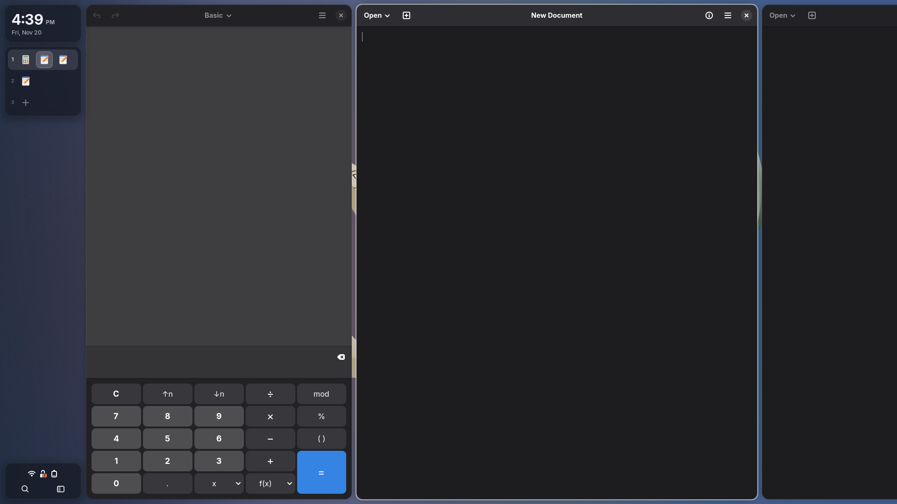

# Kelpshell

A GNOME Shell extension that replaces the top bar with a sidebar, the overview
with a launcher, and the app switcher with a window switcher, and arranges
windows in columns on a horizontal strip that scrolls. It targets GNOME 51.



The layout follows [Pond](https://www.butterfly.so/pond): a column of cards on
the left edge (clock, workspace minimap, media, notifications, status), and a
scrolling window manager in the style of niri. The launcher borrows from macOS
Spotlight, and hovering a minimap icon shows a live window thumbnail the way
the Windows 7 taskbar did.

## Install

```sh
./install.sh
```

Then log out and back in, disable any other tiling extension, and run
`gnome-extensions enable kelpshell@aicheye`. The script links the extension
into `~/.local/share/gnome-shell/extensions` and creates
`~/.config/kelpshell/config.jsonc` if it does not exist.
`./install.sh --uninstall` removes the link.

The script also builds the three native modules (`dev/build-native.sh`) when
`gcc` and the GLib headers are installed (Fedora: `sudo dnf install gcc
glib2-devel`). One lets Spotify and other apps named in `windows.crop` leave
out the frame they draw, see Replaced frames. One lets a file be
dragged out of the downloads pile and dropped on a window. One hands the
touchpad's scroll events to the extension before a window gets them, see
Scrolling in apps. Everything else works without them. They are built for the installed GNOME Shell version and
are not loaded by another one, so run `dev/build-native.sh` again after an
upgrade of GNOME.

## What it does

**Sidebar.** Cards on the left edge of the primary monitor.

- Clock. The time, the date, and the current week with today highlighted.
  Click it for the calendar and notification list.
- Minimap. One row per workspace, the icons of its windows side by side in
  strip order. The active workspace has a fill, larger icons, and one line
  of text: the title of the focused window, or of the window under the
  pointer. The line closes when no window of the workspace has the focus,
  and opens again when one does. The icons of every other workspace are
  smaller and dimmed. A row that gets higher or lower does so over 0.2
  seconds, and the card with it: after a change of workspace, when a window
  opens or closes, when a row is added or goes. Collapsed, every workspace
  is a column of icons. Click
  an icon to focus that window, click the icon of the focused window to
  minimize it, and click it again to bring it back (the icon of a minimized
  window is dimmed). Click a row to switch workspace, drag an icon
  along its row to move the window on the strip or to another row to move it
  to that workspace, scroll to switch workspace. A window dragged from the
  screen into the sidebar turns into its icon and drops the same way. Hover an icon
  for a live thumbnail. The plus on an empty workspace switches to it and
  opens the launcher.
- Monitors. One card for every monitor but the primary, with the icons of
  the windows on it in strip order and the title of the focused one.
  Workspaces are on the primary monitor only, so the card has one row. Click
  an icon to focus that window, click the row to move the focus to that
  monitor. Drag an icon from a workspace row to a monitor's card, or the
  other way, to move the window to that monitor, and along the card to move
  it on that monitor's strip. A window dragged from the screen drops on a
  card too. The plus on an empty monitor opens the launcher there.
- Media. Shown while an MPRIS player exists. Click the cover or the title to
  go to the player's window, on whichever workspace it is. A bar shows how
  far the track has played, for players that report a position and a length.
  With nothing to show, the bar closes and the card gets 12 px lower, over
  0.2 seconds. It waits 0.9 seconds first: a browser reports no length for a
  moment between two videos.
  The card shows the player that is playing. When several play, it shows
  the one that started first. When none plays, it stays with the last one.
  When the last player is gone the card gets shorter from below and fades,
  over 0.2 seconds, with the track it showed still in it, and the cards
  under it move up. It opens the same way.
- Notifications. Shown while there are notifications. Click one to open it,
  middle-click or right-click to dismiss it, middle-click the heading to
  dismiss all. The card opens and closes like the media card, and moves to
  its new height over 0.2 seconds when a notification comes or goes.
- Downloads. The five newest files of the downloads folder lying on each
  other, the newest on top, with no card around them. It works like the
  downloads stack of the macOS Dock. Under the pointer the pile spreads out
  upwards, drawn over what is above it: the five files lie to the left and
  to the right in turn, each a little higher than the one before and turned
  a few degrees, the newest lowest, and the folder stands upright over
  them. Each time the pile spreads, every file lies up to 6 px to the side
  and 4 px higher or lower than its place, and is turned up to 5 degrees
  more or less, all chosen at random. The file under the pointer grows, stands upright, and its name is
  shown next to it, moved up or down a little where that keeps it off the
  files beside it. Drag a file out of the spread pile and drop it on a window,
  which gets it as a file (a browser's upload field, a chat, a terminal,
  the file manager). Click a file to open it, right-click or
  middle-click to show it in the file manager. Click the folder for a grid
  of the eleven newest files next to the sidebar, level with the folder,
  with the folder as the last tile. The pile stays spread while the grid is
  open and closes with it. The tiles are clicked and dragged the same way, and the arrow
  keys and Enter work there too. A file that arrives grows in on top of the
  pile, and the whole pile jumps once, as the stack in the Dock does: up
  16 px (10 px collapsed) and down again with small bounces. A spread pile
  does not jump. A picture shows as itself, and any other file shows the thumbnail
  the file manager has made, or the icon of its type. Files a browser is
  still writing (`.part`, `.crdownload`) are left out. The pile is hidden
  while the folder is empty. Collapsed, the pile shows three files and
  spreads into one column straight up, the five files 40 px apart and the
  folder over them, with the same clicks, drags and names.
  `sidebar.downloads: false` hides it, and `sidebar.downloadsDir` names
  another folder. While the room between the cards over the pile and the
  pile is less than the spread pile is high (200 px with five files, 204 px
  collapsed, and
  10 px clear over the folder), the system card under it is hidden, so the
  pile lies lower and has that room. The card closes and opens over 0.2 s,
  and the pile moves with it. The card gets shorter from the top and fades,
  and its meters keep their places.
- System. Five meters: processor, memory, disk space (the share of the home
  filesystem in use), disk activity (bytes read plus written per second on
  the physical disks) and network (bytes received plus sent per second on
  the physical interfaces). The last two are on a logarithmic bar from 1 KB/s
  to 1 GB/s. Click it for the system monitor. `sidebar.system: false` hides
  it.
- Status. The top bar's status icons (network, a connected Bluetooth device,
  microphone or camera in use, a power mode other than "balanced"), then the
  battery icon with the time until the battery is empty or full next to it.
  On mains power with a full battery the icon is shown without a time. The
  row is filled up to four places, where the battery's time counts as one:
  while the icons above take fewer, the icons of `sidebar.statusFill` are
  added in their order. By default those are the power mode, then Bluetooth
  (dim while it is off). Night light has no icon unless `"nightLight"` is in
  that list. Click for quick settings.
- Volume, below the status icons: the speaker icon and a slider. A click on
  the icon mutes. A secondary click shows the output devices next to the
  sidebar, and a click on one makes it the output (arrow keys and Return
  work too). The icon shows the kind of the device: headphones, a headset, a
  display, or speakers on Bluetooth, the network or USB. For the machine's
  own speakers it shows the volume, and muted it is the muted speaker for
  every device. Collapsed, the icon alone is shown. Below it: launcher and
  collapse.

A click between the cards, or beside them, goes to the window under the
sidebar.

The sidebar collapses to a narrow strip of icons (`Super+B`). It hides while a
window is fullscreen. A three-finger swipe towards the left brings it back
over the fullscreen window, where it stays until the swipe the other way,
see Gestures.

**Scrolling window manager.** Each workspace is a strip of columns. A new
window opens as a column to the right of the focused one. The view scrolls the
least distance that keeps the focused column fully visible. Columns can hold
several windows stacked vertically. Dialogs, fixed-size windows, and windows
set to always on top float. So do windows whose maximum size is smaller than
the screen, windows with a popup window role, and a short built-in list of
popups that give the window manager no hint (1Password Quick Access,
Picture-in-Picture). A floating window of an app named in `layout.above`
(1Password by default) is set always on top, so a tiled window that gets the
focus does not cover its prompts. A new window that turns out to float after it was given
a column (a prompt that declares its fixed size late) leaves the strip, and
the strip goes back to the view and the focus it had. A new window of an app
on the built-in list (1Password) has its place at once, and the columns
after it move over 0.4 s after it is shown, when it has not left the strip
by then. A window that sets a size of its own, taller or smaller than its
place, is given the size of its place again. `Super+T` overrides
the choice for one window in either direction. A column is never narrower than its windows go: a window's
declared minimum width, or the width it kept when asked for less. `Super+R`
skips a preset that would leave the width unchanged. A column whose width
changes keeps its place in the view: at the left edge it keeps its left
edge, at the right edge its right edge, and in the middle it grows or
shrinks to both sides at once and stays centred while it does. Anywhere
else it goes to the middle. A column as wide as the view that becomes
narrower (`Super+F`, `Super+R`, `Super+-`) goes to the middle of the view,
with a part of each neighbour beside it. A new window opens right of the
focused one and is put in the middle of the view the same way. The view
never scrolls past an end of the strip: windows that are as wide as the
screen together leave no empty space beside them, so the first and the
last column stay at their end where the middle would need such space.
`Super+Shift+A` and `D` slide the focused window to the left or the right
side of the screen, `Super+Shift+W` to the middle, all within the same
limit. A width set by hand is
stored for the window's app, and the next window of that app opens at it, also
after a logout (`layout.rememberWidths`). A window that is minimized or
floated comes back at the width it had. Columns that are narrower than the
screen together sit in the middle of it (`layout.centerColumns`). A tiled
window without focus is drawn at 98% of its size, around its middle, so it
keeps its place (`windows.unfocusedScale`, 1 turns it off). So is the window
that had the focus when you go to a workspace with no window. Workspaces are stacked
vertically. During a switch each workspace slides with its wallpaper. The
space between two wallpapers is a join that slides with them and does not
change during the switch: each wallpaper runs on into it as a mirror image,
and in the middle the two are blurred and fade into each other. A column that
scrolls off to the left runs on behind the sidebar, up to the edge of the
monitor, and the cards blur the part of it that is under them. With
`theme.liveBlur: false` it fades into the wallpaper across the width the
sidebar reserves.
A new window fades in and grows from 94% of its place. While the sidebar
collapses or expands the windows keep their size, and take the new one when
the cards have theirs.

**Launcher.** Tap `Super`, or press `Super+Space`. Searches apps, open
windows, and system actions (lock, suspend, log out, restart, power off).
Below those it lists what GNOME's search providers find: files by name and
content, settings panels, browser history, and whatever else is turned on in
Settings > Search. One row sends the query to a web search (`launcher.webSearch`
in the config), and a typed web address opens in the browser.
Arithmetic is evaluated as you type, and Enter copies the result. A query that
starts with `>` runs a command. Enter opens the selected result, Ctrl+Enter
opens a new window of an app that is already running. A window the launcher
opens appears on the monitor the launcher was on. Tapping `Super` again or
pressing Escape closes it. So does a click outside it, and the focus then
goes to the window that was clicked, or to the monitor that was clicked.

**Clipboard.** `Super+V` lists what was copied lately, the newest first:
text and images, 25 entries (`clipboard.size`). The list opens at the text
cursor of the focused window, or at the pointer for a window that does not
report a text cursor. It does not take the keyboard: the window keeps the
focus and its text cursor. Up and Down move in the list. Enter or a click
puts that entry on the clipboard and pastes it into the window, with Ctrl+V,
or Ctrl+Shift+V in a terminal. `clipboard.paste: false` only copies it.
Over the launcher the list opens at the text cursor of the search field, and
Enter or a click puts the text of the entry into the field. An image goes on
the clipboard and the field stays as it is. The list does not open over
another popup.
Delete or a middle click removes an entry, Shift+Delete removes all of them.

**Emoji, emoticons and symbols.** The clipboard list is one page of a picker
with four. `Super+period` opens it on the emoji, and Tab and Shift+Tab go
from page to page. The arrow keys move in the grid, and Enter or a click
puts the chosen one at the text cursor. The picker stays open for the next
one. Typing searches the page: emoji by name ("heart", "thumbs up"), the
other pages by the title of a section ("greek", "arrows"). The search takes
a slip in a word of four letters or more ("hart", "smlie", "brithday"),
words written as one ("thumbsup") and letters left out ("hrt"). What fits
without a slip comes first. Control+BackSpace takes back a word. Over the
launcher the picker is searched and scrolled the same way, and what is chosen
goes into the search field of the launcher. The pictures
under the emoji jump to a section. What was used last is the first section
of its page. The emoji are drawn with the emoji font of the system, at
26 px: Apple Color Emoji has pictures of fixed sizes only, and 26 px is one
of them at a display scale of 1 and of 2. While
the extension is enabled it takes `Super+period` from the emoji typing of
IBus and gives it back when it is disabled.
The list keeps its place at the cursor when its height changes while it is
open, for example when something copied just before arrives in it.
Escape, `Super+V` again, a click outside the list or a change of the focused
window closes it. The list is not shown in the sidebar. It is kept in memory
only: it lasts until the session ends, and it is kept across the lock
screen. What a password manager copies is left out, for programs that mark
it with `x-kde-passwordManagerHint`.

**Shortcut sheet.** `Super+/` shows every key below as key caps, read from
the config. Any key or a click closes it.

**Window switcher.** `Alt+Tab` or `Super+Tab`. One card with a live thumbnail
of every window on every workspace, most recently used first, each with its
app icon. The selected thumbnail is larger and has the accent border, and its
title is shown under the row. A window on another workspace has that
workspace's number in the corner of its thumbnail. Hold the
modifier and press Tab or the arrow keys to move, release to focus the
selection. `W` closes the selected window. ``Alt+` `` lists only the windows
of the focused app.

**Gestures.** Three fingers on the touchpad, or four for the launcher.

- Sideways scrolls the strip. The windows follow the fingers, coast on
  release as far as the next resting place, and settle there. A resting
  place is a column at the left edge of the view, at the right edge, or in
  the middle with a part of each neighbour beside it. Fingers that are
  still moving when they lift move the focus one column over, however
  little the view moved, or after more than a third of the view width of
  travel, to a column where the view coasts to. The view then settles with
  that column in the middle, or as near to it as the ends of the strip
  allow, and never back past where the swipe began.
  A neighbour that is already whole in the view takes focus while the
  fingers are still down, after 5% of the view width of travel, and gives
  it back when the fingers return to within half of that. Focus then stays
  there however the fingers lift, unless they flick back.
  Fingers that rest before they lift only place the view, so a column can
  be put at the left or the right edge: focus stays with
  its column while that column is whole in the view. A swipe that comes
  back towards its start changes nothing. At either end of the strip the
  view stretches and springs back. When every column already fits, a swipe
  moves the focus one column left or right.
- Sideways over a fullscreen window moves one thing, which follows the
  fingers. Towards a column: the window that will take focus comes in from
  that edge of the monitor, over the fullscreen window, and stays. Back towards the
  fullscreen window: that window leaves the way it came. A swipe counts
  when the fingers are still moving as they lift, or have travelled 8% of
  the view width (or half of the way, when that is less). Otherwise
  everything goes back. Towards the left with no column on the left: the
  sidebar comes in from the left edge with the fingers, stops at its usual
  place, and stays there when they lift. Towards the right while the
  sidebar is there: the sidebar leaves with the fingers, and nothing else
  moves. A window over the fullscreen one lies one gap from the edge of the
  monitor it came in from, at any width: the left edge for a column on the
  left of the fullscreen window, in the room the sidebar has otherwise,
  and the right edge for one on the right. That holds for columns that are
  narrower than the screen together too (`layout.centerColumns` applies
  again when the window leaves fullscreen). A window at the left edge moves
  over as the sidebar comes in and back as it leaves. `Super+F` makes a
  window over the fullscreen one as wide as the monitor, less a gap on
  each side. A window that opens or closes there counts as one that came
  in or left: closing the last one returns the one before it to its edge.
  The focus keys do the same as the swipes: the window slides in or out,
  at the first column `focus-left` brings the sidebar in, and
  `focus-right` sends it out again. With two or more windows over the
  fullscreen one, a click on one of them, or the switcher, does what the
  swipes back to it do: the windows that came in after it leave the way
  they came, once the button is released. A fullscreen window keeps its
  place on the strip through a change of workspace. A swipe that begins
  while a window is still on its way out takes that window where it is:
  on out, or back to its place. With two windows over the fullscreen one,
  a swipe the same way sends the next one out. The sidebar on its way out
  is taken the same way. A swipe within 0.3 s of one the same way does
  not go on from a window to the sidebar, or from the sidebar to a window.
- Up or down switches workspace. This is GNOME's own workspace gesture,
  turned to the vertical axis.
- Four fingers up open the launcher, and four fingers down close it. The
  card follows the fingers through its opening animation, over 150 touchpad
  units of travel (half of what GNOME's overview swipe takes). When the
  fingers lift it opens or closes the way they were moving, or to the nearer
  end when they had rested. The launcher has the keyboard as soon as the
  direction of the swipe is known. Four fingers sideways scroll the strip
  as three do. `gestures.launcherSwipe: false` turns it off, and four
  fingers then switch workspace as three do.

All follow the touchpad's natural scrolling setting.

**Scrolling in apps.** Two fingers on the touchpad scroll every window the
same: as far for the same movement, and going on as long after the fingers
have left, as in Firefox. Left alone, each toolkit has its own numbers. For
one unit of what the touchpad reports a GTK 4 window moves 2.5 px, Firefox
4 px, and Chromium, Electron apps and Spotify 12 px, and after a flick they
went on for 870, 2460 and 2990 px over 2.6, 3.1 and 1.8 s (measured in the
headless shell on 2026-11-23 with the same events sent to each).

- While the fingers are on the touchpad, the events for a GTK 4 or Chromium
  window are made larger or smaller so that it moves Firefox's 4 px.
- When the fingers leave, such a window is not told. The shell sends the
  events of the movement after them itself, one for each frame, at the
  speed and with the friction Firefox would use, and tells the window that
  the scroll has ended once Firefox would have stopped.
- A Firefox window goes on after the fingers by itself. A window of
  another toolkit (Qt, GTK 3, a terminal) and the shell's own lists get
  their events as they are.
- Firefox, GTK 4 and Chromium windows get one event for each frame of the
  monitor. A touchpad reports about every 8 ms and a monitor shows a frame
  every 6.9 ms (144 Hz) or 8.3 ms (120 Hz), so events passed on as they
  come leave some frames with two and some with none. With a steady finger
  reported every 8 ms on a 144 Hz monitor, 18 of 75 frames of a GTK 4
  window moved nothing, and none do now (headless shell, 2026-11-24). The
  shell reads where the scroll was one touchpad report before each frame,
  on the line between two events, so the window follows the fingers about
  9 ms later than before. With reports that come 6 to 8 ms apart, or with
  one in twenty left out, every frame is within 3% of the others.
- The movement stops when the fingers are back on the touchpad, a key or a
  button is pressed, or the pointer is over another window.

With the same events, GTK 4, Chrome on Wayland, Chrome under Xwayland and
Spotify then ended within 2% of Firefox (1451 px in Firefox against 1443,
1436, 1424 and 1462 px after a slow flick; 4881 against 4854, 4881, 4847 and
4850 px after a faster one), at scale 1 and at scale 2.

Firefox's numbers are its own preferences (`apz.fling_friction`,
`apz.fling_min_velocity_threshold`, `apz.fling_stopped_threshold`,
`apz.gtk.pangesture.pixel_delta_mode_multiplier` and the others named in
`lib/scroll.js`). They are read from the default Firefox profile when the
shell starts and when the configuration is saved, so a value changed in
`about:config` changes every window.

`scroll.speed` is a factor on every touchpad scroll, Firefox included: 0.2 is
a fifth of what the touchpad reports. It does what `scroll-factor` of
[libinput-config](https://gitlab.com/warningnonpotablewater/libinput-config)
does. While that library is still loaded with a scroll factor of its own,
the shell divides that factor out, so the two never add up. GNOME has a
setting of this kind too (`scroll-speed` in
`org.gnome.desktop.peripherals.touchpad`), which Mutter 51.1 does not read.
`scroll.likeFirefox: false` leaves every window to its own toolkit, and
`scroll.apps` names the toolkit of a window that is not recognized.
`scroll.log: true` writes what the touchpad reported and what the windows
were sent for the last 40 scrolls to `~/.cache/kelpshell/scroll-log.json`. The mouse
wheel is not changed. This needs the native module.

**Material.** Cards show the wallpaper, blurred and tinted, at their own
screen position. The calendar popup, quick settings, notification banners,
the window switcher and the shell's prompts (authentication, passwords, audio
device, power off, permissions) get the same material. Cards are slightly translucent:
`theme.opacity` is 0.95, and 1 makes them opaque.

The sidebar's cards, the window thumbnail and the downloads grid show the
windows under them, blurred and mixed toward the tint, over that picture
(`theme.liveBlur`, on by default). Where no window is under a card, the card
is the picture alone, as before. `theme.liveBlurTint` (0.7) is how far the
blurred windows are mixed toward the tint: it is a setting of its own,
because `theme.tintStrength: 1` gives flat cards and would leave no blur to
see. The blur is 24 px wide on a 1920 px monitor. Under the sidebar the
windows are blurred between the cards too, and darkened towards black
(`theme.shade`, 0.5: a white window is mid grey at the edge of the monitor,
1 is black there, 0 turns it off). The darkening lessens from the edge of
the monitor to nothing where the work area starts, with no part at full
strength. The blur is full from the edge of the monitor across 25% of
the width the sidebar reserves (`theme.shadeRamp`), and lessens from there
to nothing where the work area starts. The blur lessens in steps: 24, 12,
6 and 3 px, each mixed into the next across a quarter of that distance, so
a line of text gets sharper towards the work area and has no edge where it
stops. The wallpaper between the windows is left as it is. With the four
blurs, frames in which a window scrolls took 2.5 ms and 3.1 ms in two runs
in the headless shell at scale 2, and 2.1 ms with only the 24 px one
(medians, 2026-11-21, before the darkening was turned on). Earlier
measurements: frames in which a window moves or draws took 2.0 ms against
1.35 ms with the fade, when only the cards blurred (measured while
scrolling two windows in the headless shell at scale 2 on 2026-11-21). With
the blur between the cards the median was 1.9 ms at scale 1, which was not
measured at scale 2. Both were measured with a 12 px blur on a picture a
quarter of the monitor. The picture is now an eighth of the monitor and the
blur 24 px, with the same number of samples, and that was not measured. `theme.liveBlur: false` gives the
picture of the wallpaper alone, and the fade under the sidebar.

**Light and dark.** Everything follows the style chosen in Settings >
Appearance. The dark style uses `theme.tint`, the light style
`theme.tintLight`. The shell's own popups and banners become light too:
stock GNOME keeps them dark in the light style.

**Lock screen.** The shell's own lock screen, which is also what a suspend
wakes to, in the look of the cards. Its wallpaper is a picture made here,
blurred and mixed toward `theme.tint` by `theme.lockTint` (0.3: the picture
keeps 70% of the wallpaper), drawn over the shell's own. The clock is the sidebar's: bold digits of one width, AM or PM
small beside them, the date under it. The password prompt is on the wallpaper, as the clock is: your
picture, your name, and an entry with a translucent dark fill and a
blinking cursor. The texts on the wallpaper have a soft shadow.
While the fingerprint reader waits, its icon shows to the right of the
entry. Each app with notifications, and each media player, is a card at the
bottom. The top bar's status icons stay where the shell puts them.

The picture of the wallpaper is a file in `~/.cache/kelpshell`. It is made
in the session, after a login and after a change of the wallpaper, the
colour scheme, the monitors or the config, so a lock does not have to make
it: a lock that did drew no frame for about a second, and the lock screen
was down without having moved.

Locking (the Lock button, Super+L) leaves the display on. After 15 seconds
without input on the lock screen it fades to black in one second and the
display goes off; input during the fade ends it. Stock GNOME fades to black
0.3 seconds after every lock and turns the display off at once. After a key
has woken the display, GNOME's power daemon turns it off again after 30
seconds without input, which is its own fixed value. Until the display goes
off the first time, `org.gnome.ScreenSaver` reports "not active" on D-Bus
while the session is locked; logind's `LockedHint` is set at once. A lock
before a suspend is not changed.

Closing the lid locks at once when the laptop's panel is the only display.
Stock GNOME locks at a lid close only as part of the suspend, and logind
starts no suspend for 30 seconds after a resume (`HoldoffTimeoutSec`) or
while GNOME's power daemon holds its lid inhibitor, which it does for 8
seconds after every change of the monitors, unplugging a dock included. A
lid closed and opened again in that time left the session open. The suspend
itself is not changed: logind still starts it at the end of that time when
the lid is still closed. With another display in use the lid does not lock,
since the session goes on there. This follows Settings > Privacy > Screen
Lock > Automatic Screen Lock, and `lock.onLidClose` turns it off.

A fingerprint that matches unlocks at once. Stock GNOME first shows every
queued message for at least two seconds, so a match right after "Failed to
match fingerprint", or in the first two seconds of the prompt, left the
lock screen standing with the entry gone.

**Window corners.** Every window is cut to one corner radius,
`focusRing.radius`, so the focus ring fits a window whatever radius the app
draws itself. The cut also removes the shadow an app draws around its own
window. Menus, tooltips and fullscreen windows are left as they are.
`windows.clipCorners: false` turns it off.

**Window outline.** Every window gets a one pixel light outline along its
edge, so a window with dark content, a browser on a black page, has an edge
on a dark wallpaper. `windows.outline: false` turns it off.

**Replaced frames.** A Chromium app on Wayland asks the compositor for a
title bar. GNOME has none to give a Wayland client, so the app draws a
fallback: a blue title bar and border inside its own window. Spotify does
this, and it then places its menu button (three dots) 26 px too high, against
that title bar. A rule in `windows.crop` names a window class whose frame the
shell replaces. The default rule is for Spotify.

With the native module (see Install) the app is told that the compositor
draws its title bar, through the `xdg-decoration` protocol that Mutter does
not have. The app then draws no frame at all, and its controls are where
they belong. Only the apps named in a rule are shown the protocol, so no
other app changes. An app that was running before the module was loaded
keeps its frame until it is started again.

Without the module the frame is cut off: the rule gives its thickness on
each side (`top: 26, right: 5, bottom: 5, left: 5` for Spotify), the window
is given a frame that much larger than its tile, and the extra is not drawn.
A cropped window has the window outline whatever `windows.outline` is. The
height of the app's title bar follows the system font, so adjust `top` if a
strip of blue is left or the top of the content is cut. Spotify's menu
button stays too high in this case. The window switcher's thumbnails show
the uncropped frame's size.

With `"titlebar": true` in the rule (the default for Spotify) a title bar is
drawn above the content: 38 px tall like the title bar GTK draws, the window
title in the system's title bar font, and the buttons of the system's button
layout (`org.gnome.desktop.wm.preferences button-layout`). Drag it to move
the window. A double click, or the maximize button, toggles the column to
full width.

A window with a rule also gets resize handles from the shell, since its
client draws no frame to resize it by: 8 px outside of each edge and 3 px
inside, around the window and its title bar, with the corners 20 px along
both edges. They draw nothing and show the resize cursor.

**Monitors.** A new window opens on the monitor that was last clicked, or
that holds the window that last took focus. The launcher and the window
switcher open there too. A hot corner opens the launcher on its own monitor.
A click on the empty desktop of any monitor takes the focus from every
window: no window has the focus ring, every tiled window is drawn at
`windows.unfocusedScale`, and the keys then act on the clicked monitor. A
secondary monitor does not scroll: its columns share the width, each in the
ratio of its proportion, so every window on it stays in view. `Super+R` and
`Super+-` / `=` give the focused column there a share of the monitor (1/3,
1/2, 2/3 for `Super+R`), and the other columns share what is left. One more
`Super+R` after the last preset lets the column share the width again. A
window that is alone on the monitor is then narrower than it and sits in the
middle.
No column there is narrower than its windows go, so no window lies over the
one next to it: `Super+F` and the width keys make a column as wide as the
minimum widths of the other columns and the gaps leave room for.
`layout.scrollSecondary: true` gives it a scrolling strip like the primary.

**Clipboard helpers.** `wl-copy` sets the clipboard by opening an invisible
window for a few milliseconds. That window is never tiled, focused by the
ring, or listed in the minimap and the window switcher, so a copy from a
terminal program does not move the strip or add an icon to the sidebar.

**Output devices.** When the output becomes another device (chosen in the
output menu, a Bluetooth speaker that connects or goes away, headphones
plugged in), every media player is paused, so what played on the speaker
does not go on from the laptop. With [EasyEffects](https://github.com/wwmm/easyeffects)
installed and running, the output preset that was loaded when that device
was last the output is loaded again. Nothing is configured for this: at each
change EasyEffects is asked which preset it has loaded, that one is stored
for the device that was the output until then, and the one stored for the new
device is loaded. A device met for the first time keeps the preset that is
loaded. The machine's speakers and its headphone jack count as two devices.
The pairs are in `~/.local/state/kelpshell/outputs.json`.
`sound.pauseOnOutputChange` and `sound.presetPerOutput` turn the two off.

## GNOME features it turns off

These repeat something Kelpshell does, or work against the column layout.
All of them come back when the extension is disabled.

| Feature | Replaced by |
| --- | --- |
| Top bar | The sidebar |
| Overview (window picker, app grid, search), and the session starting in it | The launcher and the minimap. `Super` opens the launcher |
| Three-finger swipe up into the overview | Three-finger swipe up and down switches workspace. A four-finger swipe up opens the launcher |
| Hot corner (top left) | It opens the launcher where it opened the overview, with the shell's ripple. `launcher.hotCorner: false` turns it off |
| App switcher on `Alt+Tab` and `Super+Tab` | The window switcher |
| Edge tiling (drag a window to a screen edge) | Nothing. A window dropped on the middle of a column stacks into it, and one dropped between columns becomes a column there. While dragging, a panel shows the place in a stack, a bar shows the place between two columns, and before the first or after the last column a panel shows the place and the width the window takes. The window lands on the monitor the pointer is on, also when most of the window is over the next monitor |

The hot corner and edge tiling are GNOME settings
(`org.gnome.desktop.interface enable-hot-corners`, `org.gnome.mutter
edge-tiling`). Their values are saved in
`~/.local/state/kelpshell/settings.json` before they are changed and restored
on disable, or on the next enable after a crash.

## Keys

All of these are set in the config file.

| Key | Action |
| --- | --- |
| `Super+A` / `D`, or `Super+Left` / `Right` | Focus the column to the left or right, then the monitor on that side |
| `Super+W` / `S`, or `Super+Up` / `Down` | Focus the window above or below, then the next workspace, then the monitor above or below |
| `Super+Home` / `End` | Focus the first or last column |
| `Super+Ctrl+A` / `D`, or `Super+Ctrl+Left` / `Right` | Move the column. Past the first or the last column it goes to the monitor on that side, where the opposite key brings it back. A floating window goes to that monitor too |
| `Super+Ctrl+W` / `S`, or `Super+Ctrl+Up` / `Down` | Move the window in its column, then to the next workspace, or to a monitor above or below where there is no workspace to go to |
| `Super+[` / `]` | Stack the window into the neighbouring column, or take it out of a stack |
| `Super+R` | Cycle the column width through 1/3, 1/2, 2/3. A fullscreen window leaves fullscreen for 1/3 |
| `Super+-` / `=` | Narrow or widen the column by 10% |
| `Super+Shift+-` / `=` | Shrink or grow the window in a stack |
| `Super+F` | Toggle the column to full width. A column that is already that wide, however it got there, goes back to the width it had before, or to two thirds. A fullscreen window leaves fullscreen for a column of full width |
| `Super+Shift+F` | Fullscreen |
| `Super+C`, `Super+Shift+W` | Centre the column, as far as the ends of the strip allow |
| `Super+Shift+A` / `D` | Slide the window to the left or right side of the screen (the view scrolls, the order stays) |
| `Super+Shift+S` | Minimize the window |
| `Super+T` | Float or tile the window |
| `Super+Q` | Close the window |
| `Super+Shift+T` | Open a new window of the app whose window was closed last |
| `Super+Page Up` / `Page Down` | Previous or next workspace |
| `Super+1` to `9` | Go to workspace |
| `Super+Ctrl+1` to `9` | Move the window to workspace |
| `Super` or `Super+Space` | Launcher |
| `Super+V` | Clipboard list |
| `Super+Return` | Terminal |
| `Super+E` | Files |
| `Super+B` | Collapse or expand the sidebar |
| `Super+/` | Show a sheet of these keys, as set in the config |
| `Alt+Tab`, `Super+Tab` | Window switcher (GNOME's own key settings) |

GNOME uses some of these combos by default (`Super+S` opens quick settings,
`Super+Space` switches input source, `Super+1` starts the first favourite).
While Kelpshell is enabled it removes each conflicting combo from the GNOME
setting that holds it, and puts it back when disabled. The originals are also
saved in `~/.local/state/kelpshell/keybindings.json` until then, so a shell
crash cannot lose them. `XF86Keyboard` and `Super+Shift+Space` still switch
input source.

## Configuration

`~/.config/kelpshell/config.jsonc`. See
[config.example.jsonc](config.example.jsonc) for every option and its default.
Saving the file applies it. A file that does not parse is reported in a
notification and the previous settings stay in effect.

## Trying changes without logging out

A Wayland session loads extension code once, at login. `dev/headless.sh` runs
the extension in a separate headless GNOME Shell with its own settings, so a
change can be checked without touching the running session:

```sh
dev/headless.sh start
dev/headless.sh run gnome-text-editor
dev/headless.sh key Super_L space
dev/headless.sh shot /tmp/kelpshell.png
dev/headless.sh log
dev/headless.sh stop
```

## Limits

- Tested on GNOME Shell 51.1, Wayland, in a headless session, at scale 1 and
  at scale 2. Not tested: an X11 session, fractional scale factors, monitor
  hotplug, and the touchpad gestures on real hardware. The headless session has no touchpad, so the
  swipe logic was tested by feeding it synthetic swipe events.
- The top bar is hidden, so anything that lives only there is not shown:
  app indicators from other extensions, the keyboard layout indicator, and the
  screen recording indicator.
- With `theme.liveBlur: false` the fade under the sidebar is drawn above all
  windows on the primary monitor, so a floating window dragged under the
  sidebar fades there too.
- The launcher, the cheat sheet, the window switcher and the shell's popups
  show the picture of the wallpaper and not the windows under them.
- The first use of something after a login comes up later than the later
  ones, by the time its code takes to run for the first time. Measured in
  the headless session at 144 Hz with eight windows, as the time the shell
  ran nothing else: launcher 22 to 27 ms, shortcuts 26, calendar 18, quick
  settings 22, a notification banner 50, the sidebar's collapse 55, a
  workspace switch 26, against 0 to 15 later. The animations themselves
  are the same every time. The launcher, the shortcuts, the calendar and
  the quick settings are shown once before their first use
  (`lib/warm.js`); without that they took 35, 93, 34 and 49 ms.
- On the lock screen the extension stays enabled for the look of that
  screen alone. The sidebar, the tiling and the keys are taken down while
  it shows and set up again after it. The session comes back as it was
  left: the work areas are held while the screen is locked
  (`lib/lockhold.js`), so no window is moved or resized, and the strips
  keep their columns, widths, scroll and focus, the windows floated by
  hand, and whether the sidebar was collapsed or shown over a fullscreen
  window. None of that is kept across a logout.
- The quick settings popup of the lock screen's top bar has the shell's own
  look, not the card material.
- The clipboard list keeps text and images. Copied files are kept as the
  text of their paths, so pasting one from the list into the file manager
  does not copy the file. A password manager that does not set
  `x-kde-passwordManagerHint` is recorded like any other program.
- The paste from the clipboard list is a key press. A program that pastes
  with another key than Ctrl+V, or a terminal whose window class is not in
  the list in `lib/clipboard.js`, gets the entry on the clipboard but not
  pasted.
- While the clipboard list is open, Up, Down, Tab, Enter, Delete and Escape
  go to the list and every other key goes to the window. The shell does not
  see the keys a window is given, so typing does not close the list. On the
  pages of emoji, emoticons and symbols the letters (with Shift too), the
  digits and Space go to the picker too. Other characters, such as a
  hyphen, still go to the window.
- Firefox does not tell the shell where the text cursor of a page is until
  two keys have been pressed in the field (Mutter 51 holds the position
  until Firefox's main surface commits, and pages are drawn in another
  surface). Before that the picker opens at the pointer.
- The picker has no GIF page and no skin tones.
- A file dragged out of the downloads pile can be dropped on a Wayland
  window. A window under Xwayland does not take it. A sandboxed app is given
  the path of the file and can only read it if it may read the downloads
  folder. Files cannot be dropped onto the pile.
- The darkening under the sidebar (`theme.shade`) is part of the shader that
  cuts a window's corners, so a window with neither `windows.clipCorners`
  nor `windows.outline`, and a fullscreen window, are not darkened.
- A window's new size is animated by scaling: the app draws its new size in
  one frame, and the picture is stretched from the old size to the new one
  with the spring that moves the windows. A large change shows stretched
  text for the length of the spring.
- A wallpaper that GdkPixbuf cannot read (an XML slideshow, for example) gives
  flat tinted cards.

## Firefox theme

`extras/firefox/` holds a Firefox theme in libadwaita's greys (#1d1d20,
#2e2e32 and #36363a in the dark style, #ffffff and #ebebed in the light one),
so a Firefox window has the same greys as the GTK apps and the terminal next
to it. It follows the dark and the light style, sets Firefox's theme
variables (names as of Firefox 160) and adds no layout rules. The accent is
the system accent colour.

Link it into a profile (the profile directory is listed on `about:profiles`),
then restart Firefox:

```sh
profile=~/.config/mozilla/firefox/XXXXXXXX.default-release
mkdir -p "$profile/chrome"
ln -s "$PWD/extras/firefox/userChrome.css" "$PWD/extras/firefox/userContent.css" "$profile/chrome/"
cat extras/firefox/user.js >> "$profile/user.js"
```

`user.js` also sets `browser.fullscreen.autohide` to false, so a fullscreen
Firefox window (`Super+Shift+F` or F11) keeps its toolbars and tabs. A
fullscreen video still covers the whole monitor.

To remove it, delete the two links and the lines in `user.js`. The colours are
the `--kelp-*` variables at the top of `userChrome.css`.

## Ghostty stylesheet

`extras/ghostty/resize.css` removes a grey band that Ghostty 1.4 shows for
one or two frames after its window grows (`Super+R`, `Super+F`). Ghostty
draws the terminal on its own thread, so its first frames at a new size hold
the last picture at the old size and the window background beside it. The
stylesheet gives the terminal's widget the terminal's background colour.

```sh
ln -s "$PWD/extras/ghostty/resize.css" ~/.config/ghostty/resize.css
echo "gtk-custom-css = resize.css" >> ~/.config/ghostty/config.ghostty
```

Reload the configuration in Ghostty (`Ctrl+Shift+,`). The colour is made
from libadwaita's view colour and equals the backgrounds of the Ghostty
themes "Adwaita" and "Adwaita Dark" (#ffffff and #1c1c1f). It has no
`prefers-color-scheme` media query, because Ghostty does not set the scheme
on a stylesheet that a config reload loaded.

## Layout of the code

| File | Purpose |
| --- | --- |
| `extension.js` | Starts the parts, maps key actions to them |
| `lib/config.js` | Defaults, the JSONC file, reload on change |
| `lib/spring.js` | Springs and the per-frame ticker |
| `lib/tiling.js` | Strips, columns, focus ring, the strip swipe, window actions |
| `lib/corners.js` | The corner radius every window is cut to |
| `lib/edgefade.js` | Where windows pass under the sidebar: their blur and darkening, or without `theme.liveBlur` the fade |
| `lib/glass.js` | The sidebar cards' blur of the windows under them |
| `lib/crop.js` | The rules for windows that draw a frame of their own |
| `lib/decorations.js` | Loads the native module and reads which apps it serves |
| `native/decorations.c` | The `xdg-decoration` protocol for the apps a rule names |
| `lib/titlebar.js` | The title bar drawn on a window named in a rule |
| `lib/text.js` | One-line labels that keep their height whatever script the text is in |
| `lib/widths.js` | Column widths stored per app |
| `lib/keybindings.js` | Accelerator grabs and the GNOME setting overrides |
| `lib/backdrop.js` | The blurred wallpaper material and the card shadow wrapper |
| `lib/wsslide.js` | The wallpaper and the edge fade while the workspaces slide |
| `lib/sidebar.js` | The cards and the window thumbnail |
| `lib/launcher.js` | The launcher |
| `lib/clipboard.js` | The picker: the clipboard list on `Super+V`, emoji on `Super+period` |
| `lib/glyphs.js` | The emoji, emoticons and symbols of the picker, and their grid |
| `lib/downloads.js` | The downloads pile and its grid |
| `lib/dragout.js` | Dragging a file from the shell onto a window |
| `native/drag.c` | The Wayland side of that drag: the shell as the source of a drop |
| `lib/scroll.js` | Touchpad scrolling made the same in every window: distance and movement after the fingers, as in Firefox |
| `native/scroll.c` | Gives the extension each touchpad scroll event before a window gets it |
| `lib/dialogs.js` | The shell's prompts in the look of the cards |
| `lib/picture.js` | Small pictures of image files and image data, proportions kept |
| `lib/cheatsheet.js` | The shortcut sheet |
| `lib/switcher.js` | The window switcher |
| `lib/lockscreen.js` | The lock screen: clock, prompt, notification cards, message queue |
| `lib/lockpower.js` | When the display goes off after a lock |
| `lib/lidlock.js` | A lock when the lid closes with no other display in use |
| `lib/lockhold.js` | The work areas stay as they are while the screen is locked |
| `lib/outputs.js` | A change of the output device: players paused, the EasyEffects preset of the device loaded |
| `lib/settle.js` | Animations of something just shown start once its first frame is drawn |
| `lib/warm.js` | The popups are shown once, clipped to nothing, before their first use |
| `lib/tweaks.js` | Top bar, overview replacement, workspace layout and gesture, popup anchoring |
| `lib/overrides.js` | GNOME settings changed while enabled, with a crash-safe backup |
| `stylesheet-dark.css` | All styling except the material, dark style |
| `stylesheet-light.css` | The light style, written by `dev/light-css.py` from the dark one |

Pond's shell is BSD 3-Clause licensed. Kelpshell shares no code with it.
